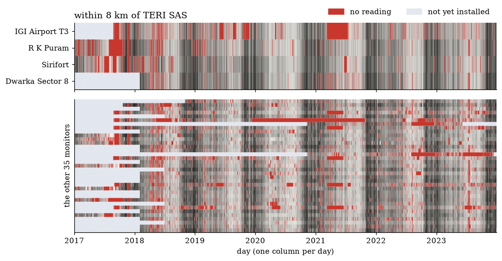
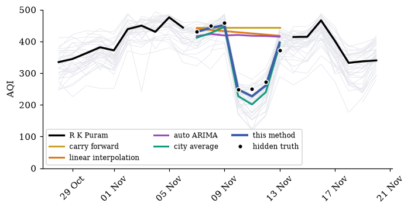

# Filling Missing Air-Quality Data with Least Squares

Delhi has 39 air-quality monitors. Put their daily AQI in one table, monitors × days for 2017–2023, and
**1 in 7** cells is blank. This repository fills the blanks with a **low-rank model fitted by alternating least
squares**, and tests it against four standard methods on readings that exist but are hidden on purpose.

The whole analysis is one notebook, [`Delhi_AQI_Imputation.ipynb`](Delhi_AQI_Imputation.ipynb), saved with its outputs.

<p align="center"></p>
<p align="center"><em>One row per monitor, one column per day. Red: no reading. Pale: not yet installed.<br>
The four monitors within 8 km of TERI SAS are on top.</em></p>

## Why the blanks matter

| | |
|:--|:--|
| **the rule** | A day needs at least **16 hours** of readings, or it gets no AQI ([CPCB, National Air Quality Index](https://cpcb.gov.in/displaypdf.php?id=bmF0aW9uYWwtYWlyLXF1YWxpdHktaW5kZXgvRklOQUwtUkVQT1JUX0FRSV8ucGRm)). In 2017, **35%** of monitor-days were blank. |
| **what goes missing** | The clean days. In 2017, **67%** of monitor-days were blank in the monsoon (Jul–Sep), against **28%** in the winter smog (Oct–Dec). |
| **the yearly mean** | The national standard's yearly figure is the mean of the readings ([NAAQS 2009](https://cpcb.gov.in/uploads/National_Ambient_Air_Quality_Standards.pdf)). For 2017 that is **244**; with the blanks filled by this method, **197**: **+47 AQI** too high. |

**Averaging just the readings we have biases the yearly average.** The bias does not depend on the model: averaging
each month's readings and weighting the month by its days in service, with no filling at all, 2017 comes to 224,
so the readings alone are still 20 points too high.

## The method

Give each monitor $s$ a list $a_s$ of 24 numbers, and each day $t$ a list $b_t$ of 24 numbers. Neither is observed:
both are learnt. A reading is their dot product, $y_{st} \approx a_s^\top b_t$, so the whole table is
$Y \approx AB^\top$ (39 × 24 times 24 × 2,556). Choose $A$ and $B$ to make

$$L=\underbrace{\sum_{(s,t)\ \text{observed}}\big(y_{st}-a_s^\top b_t\big)^2}_{\text{fit the readings}}
+\underbrace{\lambda\Big(\sum_s\|a_s\|^2+\sum_t\|b_t\|^2\Big)}_{\text{keep the lists small}}
+\underbrace{\gamma\sum_t\|b_t-b_{t-1}\|^2}_{\text{the city changes gently}}$$

as small as possible, by **alternating least squares**:

1. Start with a random $B$.
2. Fix $B$. Each monitor's list is a ridge regression on the days it reported:
   $\hat a_s=(B_s^\top B_s+\lambda I)^{-1}B_s^\top y_s$. Stack the 39 lists as the rows of $A$.
3. Fix $A$. Each day's list is a ridge regression on the monitors that reported that day, pulled towards its
   neighbouring days. Stack the 2,556 lists as the rows of $B$.
4. Repeat steps 2–3 (40 rounds, a few seconds). Each blank is then $\hat a_s^\top\hat b_t$.

## Results

Hide readings we have, refill them, and score the refill: RMSE in AQI points, lower is better.

| method | uses | R K Puram, 7–13 Nov 2023 | random days, 10-fold CV |
|:--|:--|--:|--:|
| carry forward | the monitor's own past | 126 | 57.3 ± 0.2 |
| linear interpolation | the monitor's own past and future | 113 | 43.1 ± 0.1 |
| auto ARIMA | the monitor's own series | 109 | 50.9 ± 0.2 |
| city average | the other monitors that day | 27 | 40.0 ± 0.2 |
| **this method** | **both** | **14** | **24.1 ± 0.2** |

<p align="center"></p>

**R K Puram's own readings could not see the dip of 10–12 Nov; the other monitors did.**

* **R K Puram's week.** Its seven readings of 7–13 Nov 2023 are hidden once; every method refills them.
* **Random days.** The 73,498 readings are dealt at random into 10 piles of about 7,350. Each pile is hidden in turn:
  every method is fitted on the other nine and scored on the hidden one, so every reading is scored once.
  ± is the standard error over the 10 piles.
* **Tuning.** This method's $f$, $\lambda$, $\gamma$ are chosen inside each fold on a different pile, so the scored
  pile never helps choose them.
* **Auto ARIMA** is [statsforecast](https://github.com/Nixtla/statsforecast)'s `AutoARIMA` (Hyndman–Khandakar stepwise
  search by AICc). It needs an unbroken series, so each monitor's blanks are first filled by straight lines; each
  hidden day is then predicted from the days before it.

The notebook also covers whole hidden weeks, the method without its smooth term, and filling each new day as it comes.

## Run it yourself

You need Python 3.12 (the version used) and about 9 minutes.

```bash
git clone https://github.com/vedpiyush93-stack/Delhi_AQI_Imputation.git
cd Delhi_AQI_Imputation

python3.12 -m venv .venv
source .venv/bin/activate           # Windows: .venv\Scripts\activate
pip install -r requirements.txt     # the exact versions used

jupyter lab Delhi_AQI_Imputation.ipynb
```

Then **Run All**. In VS Code, open the notebook and pick the `.venv` interpreter as its kernel.

* Section 5 (cross-validation) refits every method 20 times: about 9 minutes on 16 cores, longer on a laptop.
  Progress bars show how far it has got.
* To skip it, set `RUN_CV = False` in the first code cell; the notebook then loads `results/cv_folds.csv`.
* The piles are dealt with fixed seeds, so a rerun hides the same readings.

Tested on macOS (Apple silicon), Python 3.12.2, with the versions in `requirements.txt`.

## What is here

| path | what |
|:--|:--|
| `Delhi_AQI_Imputation.ipynb` | the whole analysis, top to bottom, with commentary and saved outputs |
| `data/raw/` | 39 hourly AQI files, one per monitor, as downloaded (`urls.txt` lists each source link) |
| `data/delhi_daily_aqi.csv` | the daily table the notebook builds from `data/raw/` (39 monitors × 2,556 days) |
| `data/station_coordinates.csv` | the TERI SAS campus and the four monitors within 8 km |
| `results/cv_folds.csv` | RMSE of every method on every fold (written by the notebook) |
| `figures/` | the two figures above, from the notebook |
| `requirements.txt` | the exact package versions |

## Data and sources

* **AQI readings.** [OpenCity, *Delhi Hourly Air Quality Reports*](https://data.opencity.in/dataset/delhi-hourly-air-quality-reports),
  from monitors run by CPCB, DPCC, IMD and IITM; the licence is listed there as public domain. One CSV per monitor:
  each month is a block of rows, one row per day, one column per hour.
* **Daily values.** A day counts only if at least 16 of its 24 hours were reported, the rule in CPCB's National Air
  Quality Index report. The daily value is the mean of those hours, capped at 500.
* **Coordinates.** Miinalainen et al. (2022), supplement to ACP discussion paper acp-2022-513, Table S1. Campus pin
  from the map on the [TERI SAS contact page](https://www.terisas.ac.in/contact-us.php).

## Author

Ved Piyush
